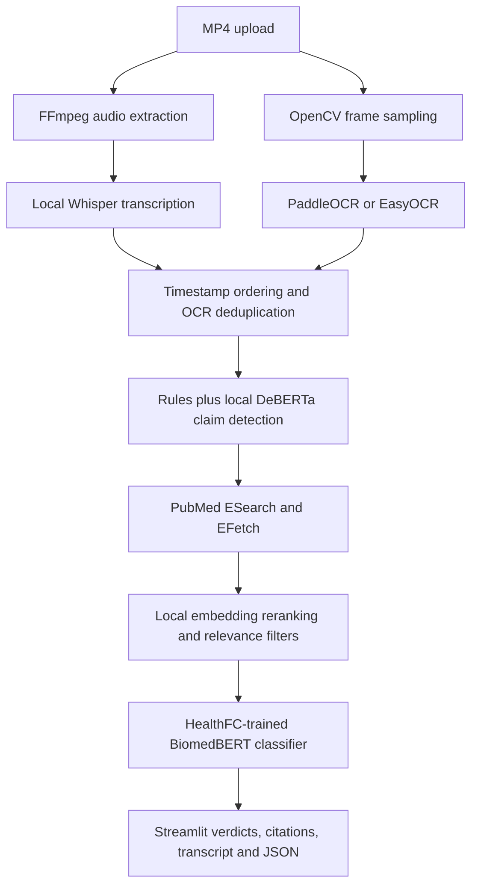

# Project analysis — Biomedical Video Fact Checker

Reviewed on 13 September 2026. Project version: 0.3.4.

The project has a useful modular architecture and a saved trained classifier, but several implementation defects can change or misrepresent its conclusions. Its strongest completed work is the separation of video processing, claim detection, retrieval, and classification. Its most important remaining work is preserving claim meaning, reporting evidence accurately, and evaluating on independent sources and real videos.

This was an analysis task. Application code, configuration, trained weights, and existing tests were left unchanged. Review scripts and observations were added under `work/project_analysis/`.

## Scope and verification

Reviewed all 21 Python files under `src/biomed_video_fc`, the application entry point, existing tests, installer, configuration, documentation, package metadata, the complete HealthFC CSV, trained model configuration/training report, and the six release ZIP files. Third-party packages and binary weights were not audited internally.

| Check | Result |
|---|---|
| Existing pytest suite | **15 passed, 1 failed**, 17.20 seconds |
| Ruff: source, tests, entry point | Passed |
| Python compilation: source, tests, entry point | Passed |
| Installed dependency consistency: `pip check` | Passed |
| Review probes | Two probe functions completed successfully, covering data, retrieval, claim handling, tokenization, and Streamlit rendering |
| Coverage reported by existing test run | 63% statement coverage for the modules listed by coverage |
| Actual video inference / live PubMed / retraining | Not performed |

The 63% figure is not comprehensive whole-project coverage: the report did not enumerate the unimported UI and offline-index modules. The real media and model adapters have substantial untested paths. The probes record current behavior, including defects; their passing status does not mean the defects are fixed.

The initial sandbox could not access the Python installation behind `.venv`. Tests succeeded in starting outside the sandbox with approval, using Python 3.11.9. This was an access restriction, not evidence of a broken virtual environment.

Reproducible observations are in [observations.json](C:/Users/DELL/Documents/Codex/2026-09-01/i-am-building-a-final-year/work/project_analysis/observations.json); the probe implementation is [review_probes.py](C:/Users/DELL/Documents/Codex/2026-09-01/i-am-building-a-final-year/work/project_analysis/review_probes.py).

## What the system does

The diagram shows data dependencies. The implementation runs these stages sequentially; the speech and frame branches do not execute concurrently.

| Component | Assessment |
|---|---|
| Domain models and protocols | Typed Pydantic records and injected interfaces make most stages easy to isolate and replace. |
| Configuration and factory | TOML plus environment overrides; optional dependencies load mostly on demand. Some readiness and cross-field validation happens too late. |
| Media and speech | Bundled FFmpeg fallback, mono PCM extraction, and timestamp preservation are useful. Global input limits need earlier enforcement. |
| OCR and merger | Both OCR adapters exist, including PaddleOCR interface compatibility. Text deduplication currently loses medically meaningful differences and timing gaps. |
| Claim detector | Uses rules before zero-shot scoring. Some rules are tailored to a vitamin-C example and reduce generality. |
| Live retrieval | Official NCBI endpoints, relevance ordering, retries, and instance-level rate limiting are implemented. Failure and relevance filtering need correction. |
| Verifier | Performs local claim/evidence classification. Explanation and per-paper stance are constructed by code, not independently established by the model. |
| Training and metrics | Stratification, class weighting, validation selection, and held-out evaluation exist. Source grouping and a fuller experiment record are missing. |
| Streamlit | Displays transcripts and evidence and exports JSON for nonempty claim results. Upload identity and state handling need correction. |
| Optional offline retrieval | Separate XML-to-CSV and FAISS commands exist; the application factory always uses live PubMed. |

The current combination of speech and OCR is a union of candidate claims plus duplicate merging. It does not generally synthesize complementary information across modalities.

## Findings to address first

**1. High — deduplication merges contradictions and different doses.**

[Claim deduplication](C:/Users/DELL/Documents/Codex/2026-09-01/i-am-building-a-final-year/src/biomed_video_fc/claims/extractor.py:260) uses character similarity without protecting negation, numbers, units, or entities. The probe supplied speech saying “Drug A is effective for reducing fever” and OCR saying “Drug A is not effective for reducing fever.” The result contained only the positive claim, marked `source="both"`.

[OCR deduplication](C:/Users/DELL/Documents/Codex/2026-09-01/i-am-building-a-final-year/src/biomed_video_fc/text/merger.py:26) similarly collapsed 10 mg and 100 mg captions into the 10 mg caption. It also merged identical captions at 0 and 100 seconds into a continuous 0–101 second interval.

Preserve negation, dosage, units, and entity differences before deduplication. Merge only temporally adjacent OCR occurrences and retain separate occurrence spans. Add regression cases for contradictions, decimals, unit changes, and repeated captions after gaps.

**2. High — the saved evaluation splits overlap by source article.**

[Training splits](C:/Users/DELL/Documents/Codex/2026-09-01/i-am-building-a-final-year/src/biomed_video_fc/training/healthfc.py:116) split individual rows and discard the source URL from the training example structure. The CSV has 750 unique claims but only **648 source URLs**.

The supplied split IDs are disjoint and cover all rows. However, **20 of 113 test rows (17.7%)** and **13 of 113 validation rows (11.5%)** share a source URL with training rows. Overall, 37 source groups cross partitions. Rows 145 and 146 also have identical evidence text across validation and test.

This is source overlap, not duplicate claim IDs. It can make performance look stronger than performance on unseen articles; the amount of inflation has not been measured. Retain source identifiers and create grouped splits by canonical article URL, checking exact and near-duplicate evidence. Re-run the experiment before describing the score as generalization to unseen sources.

**3. High — citation stance is assigned without testing each paper.**

[Citation construction](C:/Users/DELL/Documents/Codex/2026-09-01/i-am-building-a-final-year/src/biomed_video_fc/reasoning/local_classifier.py:95) labels the first two retrieved PMIDs as supporting whenever the aggregate verdict is TRUE, and contradicting whenever it is FALSE. No paper-level stance prediction supports those labels.

An abstract can be relevant while disagreeing with the final verdict. Present papers as retrieved evidence until their individual stance has been assessed. Generate an explanation from the passages actually used, and preserve conflicting evidence.

**4. High — the classifier can ignore abstracts that the explanation claims it compared.**

[Evidence tokenization](C:/Users/DELL/Documents/Codex/2026-09-01/i-am-building-a-final-year/src/biomed_video_fc/reasoning/local_classifier.py:78) concatenates all abstracts and truncates the second sequence to fit the 512-token budget. A local-tokenizer probe with three abstracts showed that a long first abstract removed the second and third entirely.

The explanation still says it compared all retrieved abstracts, and the second paper can still be listed as a citation. Allocate a passage budget per document, or classify each claim/passage pair and aggregate. Record exactly which passages and PMIDs reached inference.

**5. High — reranker failure becomes silent evidence loss.**

[Reranker fallback](C:/Users/DELL/Documents/Codex/2026-09-01/i-am-building-a-final-year/src/biomed_video_fc/retrieval/pubmed_api.py:296) logs that PubMed order is preserved and returns unscored evidence. [The subsequent filter](C:/Users/DELL/Documents/Codex/2026-09-01/i-am-building-a-final-year/src/biomed_video_fc/retrieval/pubmed_api.py:153) rejects every item with a missing relevance score.

The probe fetched one usable abstract and simulated an unavailable embedding dependency. The retriever returned zero abstracts. The reasoner then produced NEI with a fixed confidence of 0.99 and a message suggesting no usable evidence was found.

Represent retrieval errors and unavailable reranking explicitly. Either stop that claim with an understandable status, or use a documented fallback with an appropriate independent relevance check. Also keep relevance policy explicit when `semantic_rerank=false`, which currently bypasses these filters altogether.

**6. High — negation filtering can remove direct contradictory evidence.**

[Negation gate](C:/Users/DELL/Documents/Codex/2026-09-01/i-am-building-a-final-year/src/biomed_video_fc/retrieval/pubmed_api.py:92) requires an abstract to contain a negation word whenever the claim contains one. It does not determine what is being negated.

For a synthetic negative claim about Drug A, an affirmative abstract stating the opposite was rejected despite 0.95 relevance. Conversely, an unrelated “not” elsewhere can satisfy this gate. Determine whether a paper addresses the claim's subject and relation independently of whether its conclusion agrees. Assess stance separately.

## Reliability and product gaps

**7. Medium — a new video can display the previous video's conclusions.**

[Upload and session state](C:/Users/DELL/Documents/Codex/2026-09-01/i-am-building-a-final-year/src/biomed_video_fc/ui/streamlit_app.py:146) do not associate `analysis_result` with the upload. AppTest confirmed an old claim still rendered after substituting a new upload. A failed reanalysis also leaves the earlier result available.

Tie results to an upload fingerprint and analysis settings. Clear or visibly separate stale results on upload changes and failed analyses. Preserve `uploaded.name`: the current JSON stores the generated temporary MP4 filename from the pipeline.

**8. Medium — candidate rules discard legitimate claims and complementary OCR.**

[Candidate rules](C:/Users/DELL/Documents/Codex/2026-09-01/i-am-building-a-final-year/src/biomed_video_fc/claims/extractor.py:20) omit common verbs such as “treats” and “cures,” reject short claims, and reject an entire OCR segment containing “PMID,” “journal,” or similar citation markers.

Probes dropped “Drug A treats bacterial infections” and a complete claim accompanied by a PMID. With speech “Drug A lowers fever” and OCR “Works in 10 minutes,” only the speech claim survived.

Separate citation/boilerplate lines from claim text. Expand validation beyond the vitamin-C examples. If complementary fusion is a project objective, implement temporal/entity alignment and test it directly. The current pipeline test injects a fake claim extractor that supplies a fused claim; it does not prove the production extractor can do this.

**9. Medium — the duration limit does not limit speech processing.**

[Pipeline ordering](C:/Users/DELL/Documents/Codex/2026-09-01/i-am-building-a-final-year/src/biomed_video_fc/pipeline.py:77) extracts and transcribes all audio before [frame extraction checks duration](C:/Users/DELL/Documents/Codex/2026-09-01/i-am-building-a-final-year/src/biomed_video_fc/media/processors.py:93). An overlong-video exception is then treated as an optional OCR failure, allowing speech-only analysis to finish. FFmpeg also has no process timeout.

Validate duration, size, and decodability before expensive work. Apply the limit to the whole video and bound subprocess execution. This is relevant to predictable processing time and resource consumption.

**10. Medium — readiness, caching, and failure handling need stronger contracts.**

The sidebar [checks only config.json](C:/Users/DELL/Documents/Codex/2026-09-01/i-am-building-a-final-year/src/biomed_video_fc/ui/streamlit_app.py:120) to call the classifier ready. It does not validate weights or tokenizer availability, and missing configuration does not disable analysis. [Each click constructs a new pipeline](C:/Users/DELL/Documents/Codex/2026-09-01/i-am-building-a-final-year/src/biomed_video_fc/ui/streamlit_app.py:169), losing its instance-level model caches.

Preflight required artifacts and configuration. Cache reusable model resources with explicit device/model keys. Normalize model-loading failures into application errors; PaddleOCR initialization occurs outside its per-frame exception wrapper, so some initialization errors abort analysis despite usable speech. If multiple users are supported, share rate-limit coordination appropriately; current limits apply separately to each retriever.

**11. Medium — confidence and audit records need clearer meaning.**

[No-evidence NEI](C:/Users/DELL/Documents/Codex/2026-09-01/i-am-building-a-final-year/src/biomed_video_fc/reasoning/local_classifier.py:68) receives 99% confidence without model inference. Other confidences are raw softmax outputs. These are different quantities presented in the same field. No calibration or abstention policy is implemented.

Separate decision source, retrieval status, evidence sufficiency, and model confidence. Calibrate on held-out validation data and test abstention on unrelated/partial evidence. Existing JSON preserves returned evidence and timings, but not complete candidate lists, rejected-item reasons, effective settings, model/checkpoint hashes, or exact model input passages.

**12. Low to medium — upload/export behavior differs from configuration.**

`config/default.toml` declares 500 MB, but `.streamlit/config.toml` does not set `server.maxUploadSize`, and the uploader supplies no override. The installed Streamlit source defaults to 200 MB. Unless overridden externally, the uploader blocks files before the application's 500 MB check.

The zero-claim renderer returns before processing details and JSON export; AppTest confirmed no download button appears. Keep audit export available even when no claims are detected.

## Dataset and saved experiment

All 750 rows contain claim and evidence input. The local label mapping and dataset counts agree:

| Class | Dataset rows | Saved test precision | Saved test recall | Saved test F1 |
|---|---:|---:|---:|---:|
| TRUE | 202 | 83.87% | 86.67% | 85.25% |
| FALSE | 125 | 66.67% | 84.21% | 74.42% |
| NEI | 423 | 94.83% | 85.94% | 90.16% |

The saved [training report](C:/Users/DELL/Documents/Codex/2026-09-01/i-am-building-a-final-year/artifacts/healthfc_classifier/training_report.json) records:

- Train/validation/test sizes: 524 / 113 / 113, seed 42.
- Four training epochs; epoch 2 had the best validation macro-F1, approximately 0.777.
- Test accuracy: **85.84%**, or 97 correct out of 113.
- Test macro-F1: **0.8328**.
- Test NEI prediction rate: **51.33%**.
- Majority-class accuracy on that test partition: **56.64%**.

These metrics were read from the saved report and checked for consistency; checkpoint inference was not rerun. FALSE is the weakest class by F1, and one-third of its predicted FALSE labels were wrong on this partition.

Training correctly excludes `en_explanation`, applies class weights, selects checkpoints using validation macro-F1, and evaluates the selected checkpoint on test. Excluding the explanation does not eliminate the source-overlap issue or the difference between consumer-facing HealthFC evidence and runtime PubMed abstracts.

The report lacks several reproducibility fields: complete training arguments, chosen epoch, dependency versions, dataset hash, model revision/checkpoint hash, hardware, calibration results, and per-example predictions. The review observations include a dataset SHA-256 and the currently installed package versions, but these do not prove which environment produced the historical checkpoint.

Before the final-year evaluation, use source-grouped splits and multiple seeds, then evaluate a separate annotated video set. Measure speech transcription, OCR, claim extraction, candidate retrieval, final verdicts, calibration, and latency separately. Include speech-only, OCR-only, combined, contradictory, and complementary cases to establish the benefit of visible-text analysis.

## Tests, packaging, and maintenance

The existing failure is [the cross-segment claim test](C:/Users/DELL/Documents/Codex/2026-09-01/i-am-building-a-final-year/tests/test_core.py:175): expected “When vitamin C is low” versus actual “When Vitamin C is low.” It is a capitalization mismatch, not failure to reconstruct that sentence. Decide whether casing is a required output contract before changing the test or implementation.

There are 16 existing tests. Prioritize new regression coverage around findings 1–9, model loading, corrupted/no-audio videos, OCR fallback, PubMed failures, and genuine classifier input handling. Mocked orchestration is useful but cannot replace a small representative video set.

Package management is coherent and `pip check` passes in this environment. However, broad dependency ranges and no lockfile make installation less reproducible. The `all` extra includes PaddleOCR but not EasyOCR or the optional FAISS stack; using `ocr.engine="easy"` requires its separate extra.

No Git repository or CI configuration was present in the supplied directory. The reviewed ZIPs are source distributions without model weights. The versioned v0.3.4 archive differs byte-for-byte from the workspace in nine files, including retrieval, claim extraction, UI, and configuration. The unversioned ZIP also differs. Do not assume a ZIP represents the code reviewed here; generate releases from an identified source revision.

The saved classifier weights occupy about 418 MiB. The existing milestone document still describes training as acceptance work, despite the present checkpoint and report. Update milestone status with measured evidence, distinguishing implemented code from completed experiments.

## Security, privacy, and operating limits

The application passes FFmpeg an argument list without invoking a shell, uses fixed HTTPS NCBI endpoints, and removes temporary media through scoped directories/finally cleanup. No hosted reasoning-model integration was found in the runtime source.

Claim text and configured NCBI identity/key are transmitted to NCBI. Model downloads can also contact model hosts when caches are missing; inference being local does not make first-use execution fully offline. Video identity and session isolation deserve particular attention because stale results are currently possible.

This is a local research prototype with no application authentication or background job system. Public hosting would need an explicit access and resource-management design. The review did not include a dependency vulnerability scan, penetration test, full model execution, or independent verification of the external CER comparison.

## Recommended implementation order

1. Preserve negation, quantities, entities, and timing during deduplication.
2. Correct retrieval failure states, negation filtering, passage budgeting, and citation stance.
3. Bind UI results to uploads; enforce early limits and artifact readiness.
4. Add focused regressions, a verified model cache, and representative video smoke tests.
5. Retrain/evaluate with grouped source splits, then complete video ablations and calibration.
6. Record experiment/release provenance and refresh the documentation and distribution archive.

The architecture is suitable for continuing the final-year project. The current score and interface should be described as prototype results until these correctness issues and evaluation gaps are resolved.

